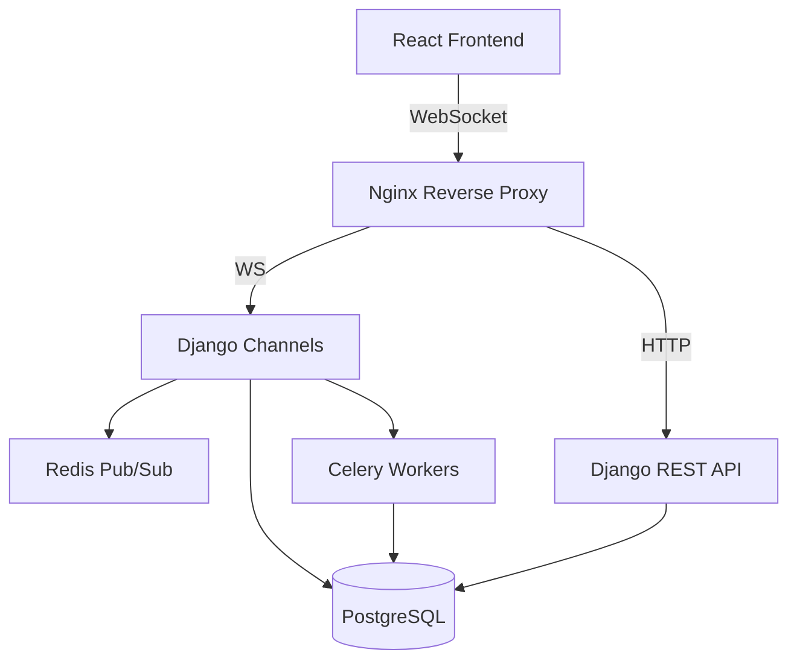
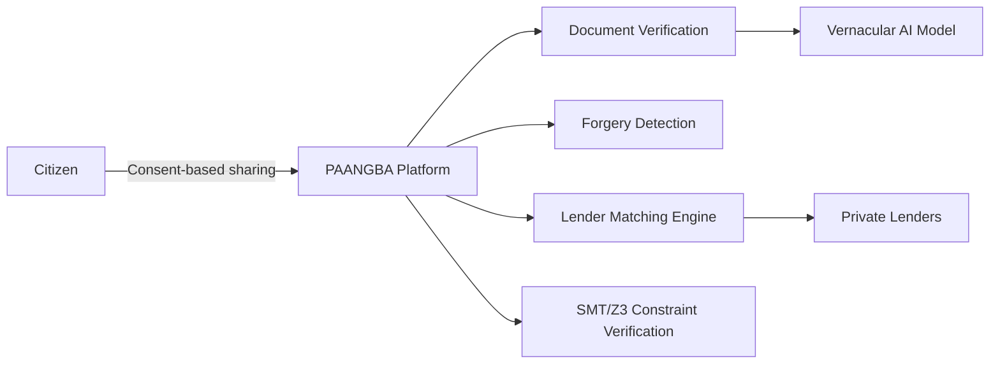
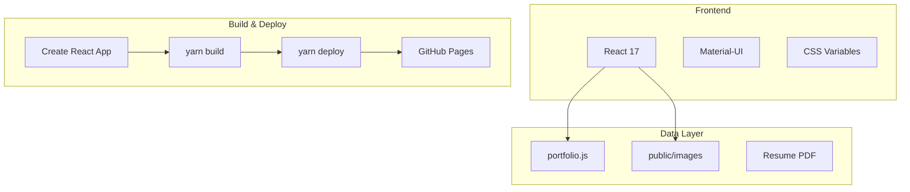

# Engineering & Technology Portfolio

> A technology-focused portfolio documenting implemented systems, experimental research, and infrastructure explorations across AI, distributed systems, cybersecurity, and full-stack engineering.

---

## Technology Overview

This repository hosts a personal portfolio built on top of the [Cleanfolio](https://github.com/rjshkhr/cleanfolio) React template (MIT License). The portfolio itself is a static React application, but the projects it documents span a wide range of engineering domains — from real-time multiplayer systems and AI-assisted platforms to offline mesh networking and local LLM inference.

The focus is on **building things that work**, understanding systems at a fundamental level, and experimenting with emerging technologies without overclaiming maturity.

---

## Technology Ecosystem

### Implemented Systems

| Project | Domain | Status | Stack |
|---|---|---|---|
| **PAANGBA** | AI-assisted financial access & lender matching | In development | Python, Django, React, AI/ML (document verification, forgery detection, vernacular model fine-tuning) |
| **HOUSIE** | Real-time multiplayer gaming platform | Deployed | Django, Django Channels, WebSockets, Redis, Celery, React, Docker, Nginx, Linux VPS |
| **Coaching Website** | Serverless content management | Live | React, Google Apps Script, Google Drive, Google Sheets |
| **Offline Mesh Communication** | Disaster relief camp networking | In progress | Mesh networking, offline-first architecture |

### Explored Technologies

These are technologies I have studied, experimented with, or integrated at a prototype level:

- **AI/ML**: RAG (Retrieval-Augmented Generation), Ollama, Qdrant (vector database), LLM grounding, local LLMs (Llama, Qwen), embeddings, SMT/Z3 constraint reasoning
- **Real-time systems**: WebSockets, Django Channels, Redis pub/sub, Celery task queues
- **Infrastructure**: Docker, Nginx (reverse proxy + SSL), Linux VPS, PostgreSQL
- **Languages**: Python, C, JavaScript, TypeScript, SQL

### Planned / Future Explorations

- Vernacular AI model fine-tuning for low-resource languages
- Zero-trust architecture and network security hardening
- Edge computing and distributed inference
- Peer-to-peer protocols beyond mesh networking
- Formal verification of AI-generated recommendations

---

## Architecture Diagrams

### HOUSIE — Real-Time Multiplayer Platform



### PAANGBA — AI-Assisted Lender Matching



### Offline Mesh Communication — Disaster Relief

```mermaid
graph LR
    CampA[Relief Camp A] -->|Mesh Node| MeshNet[Offline Mesh Network]
    CampB[Relief Camp B] -->|Mesh Node| MeshNet
    CampC[Relief Camp C] -->|Mesh Node| MeshNet
    MeshNet --><|message|>Store & Forward| Data[Information Distribution]
    Internet((Internet)) -.->|When available| MeshNet
```

---

## Engineering Projects (Architecture-Focused)

### 1. PAANGBA — AI-Assisted Financial Access & Lender-Matching Platform

**Domain:** Applied AI / Financial Inclusion  
**Status:** In development (2026)

A platform designed to connect citizens seeking financial assistance with relevant private lenders through consent-based information sharing. The system explores:

- **Document verification** and forgery detection pipelines
- **AI-assisted matching** between applicants and lenders
- **Vernacular AI model fine-tuning** for low-resource language support
- **SMT/Z3 constraint reasoning** to verify AI-generated recommendations against structured eligibility rules, reducing hallucination risk

The architecture treats AI as a recommendation layer, not a decision layer — every AI output is cross-checked against explicit logical constraints.

### 2. HOUSIE — Real-Time Multiplayer Gaming Platform

**Domain:** Real-time systems / Event-driven architecture  
**Status:** Deployed (2026)

A real-time multiplayer Housie (Tambola) platform with automated gameplay, ticket management, and prize validation.

**Key engineering decisions:**
- **Django Channels** + **WebSockets** for persistent real-time connections
- **Redis pub/sub** for message broadcasting across instances
- **Celery** for background game operations (number calling, prize validation)
- **Docker** containerization with **Nginx** reverse proxy and SSL on a Linux VPS
- **PostgreSQL** for persistent game state and player data

### 3. Coaching Website — Serverless Content Management Platform

**Domain:** Serverless architecture / Cost optimization  
**Status:** Live (2026)

A platform for students to access learning materials and teachers to upload/manage educational resources.

**Key engineering decisions:**
- **Google Apps Script** as the backend runtime (serverless, zero hosting cost)
- **Google Drive** for file storage (PDFs, images, resources)
- **Google Sheets** for structured data and activity logging
- No separate database or hosting required — leverages existing Google infrastructure

### 4. Offline Mesh Communication for Disaster Relief Camps

**Domain:** Distributed systems / Resilient networking  
**Status:** In progress (2026)

An offline-first communication system designed to connect nearby relief camps through a mesh network when internet connectivity breaks down.

**Key concepts:**
- **Store-and-forward** message routing between nodes
- **Information forwarding** without continuous internet
- **Offline-first** architecture for disaster-response resilience
- Designed for environments with unreliable or no connectivity

### 5. AI-Driven Scheme Matching for Marginalized Entrepreneurs

**Domain:** Applied AI / Government technology  
**Context:** Smart India Hackathon 2026 (Team Leader)

A solution to match entrepreneurs with relevant government schemes based on eligibility.

**Key concepts:**
- **RAG** (Retrieval-Augmented Generation) for scheme retrieval
- **Structured constraint logic** (SMT/Z3) for eligibility verification
- **Grounded recommendations** — AI generates suggestions, logic validates eligibility
- Multilingual support considerations

### 6. Applied LLM & RAG Pipeline Architecture Exploration

**Domain:** AI systems research  
**Context:** Applied research (2026)

Evaluated local AI systems and developed workflows for reliable, context-aware responses.

**Key concepts:**
- Local LLM inference (Ollama, Llama, Qwen)
- Dense embeddings and semantic search
- Context-grounding checks to reduce unsupported outputs
- Linux service administration (containers, reverse proxies, caching, task queues)
- Practical network security exposure

---

## Infrastructure & Development Environment

### Tools & Platforms

| Category | Technologies |
|---|---|
| **Languages** | Python, C, JavaScript, TypeScript, SQL |
| **Backend** | Django, Django REST Framework, WebSockets, Celery, Redis |
| **Frontend** | React, Material UI |
| **Databases** | PostgreSQL, Redis (in-memory) |
| **AI/ML** | Ollama, Qdrant, RAG pipelines, embeddings, SMT/Z3 |
| **Containers** | Docker, Nginx |
| **OS** | Linux, Linux VPS |
| **Version Control** | Git |
| **Portfolio** | React 17, Create React App, Material-UI, gh-pages |

### Portfolio Architecture



---

## Hackathons & Recognition

| Event | Role | Result |
|---|---|---|
| Smart India Hackathon 2026 | Team Leader | Selected through NIT Manipur's internal hackathon for the National Stage |
| AI for Seva Hackathon 2026 | Team Leader | 5th prize among 52 teams (Department of IT, Government of Manipur) |
| PAANGBA Solution | Contributor/Lead Research | Recognised with potential incubation and grant opportunities |
| Intra-NIT Football | Player | Champion |
| Inter-NIT Badminton | Representative | Selected |

---

## Academic Background

**National Institute of Technology Manipur** — B.Tech in Computer Science & Engineering

- **Semester:** 3rd (2025–2029, ongoing)
- **CGPA:** 8.33/10
- **Coursework:** Data Structures & Algorithms, Discrete Mathematics, Digital Logic Design, Programming in Python, Mathematics for Computing, Managerial Economics

---

## Technology Badges


---

## Resources & References

| Resource | Description |
|---|---|
| [Cleanfolio Template](https://github.com/rjshkhr/cleanfolio) | Original portfolio template (MIT License) |
| [Django Channels](https://channels.readthedocs.io/) | WebSocket support for Django |
| [Ollama](https://ollama.ai/) | Local LLM inference |
| [Qdrant](https://qdrant.tech/) | Vector database for semantic search |
| [Z3 Theorem Prover](https://github.com/Z3Prover/z3) | SMT solver for constraint verification |
| [Docker Documentation](https://docs.docker.com/) | Containerization reference |
| [Nginx Documentation](https://nginx.org/en/docs/) | Reverse proxy and web server |

---

## Running Locally

```bash
git clone https://github.com/heeraOp/github_portfolio.git
cd github_portfolio
cd cleanfolio
yarn install
yarn start
```

Production build:

```bash
yarn build
```

---

## License

MIT License — see [LICENSE](LICENSE) for details.

Original template: [Cleanfolio](https://github.com/rjshkhr/cleanfolio) by Raj Shekhar (MIT License).

---

*This README documents verified implementations and explorations. Technologies listed under "explored" represent study and experimentation, not production deployment.*